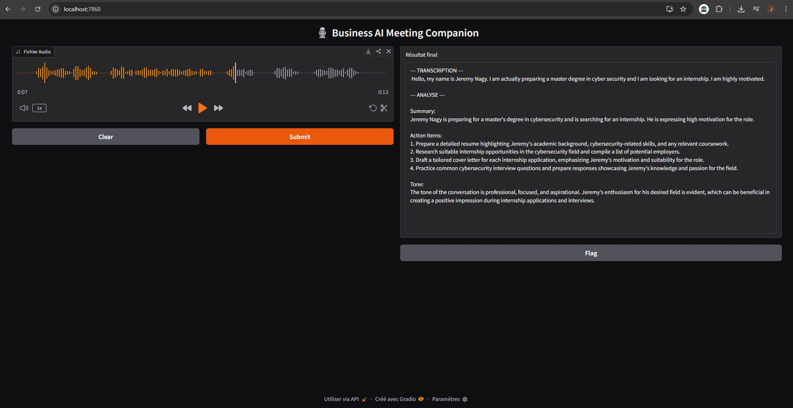
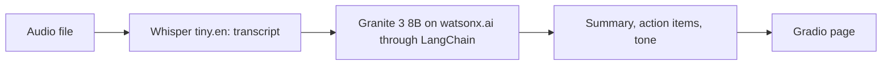

# Business AI Meeting Companion

Turns a meeting recording into a transcript, a summary, an action plan and a tone analysis.

Guided project from the IBM AI Developer professional certificate.



## How it works



## Stack

Python · Transformers (Whisper) · LangChain · IBM watsonx.ai (Granite) · Gradio

## Run it

You need an IBM watsonx.ai account.

```bash
git clone https://github.com/JN13012/Business_AI_Meeting_Companion_STT
cd Business_AI_Meeting_Companion_STT
python3 -m venv .venv
source .venv/bin/activate
pip install -r requirements.txt
```

Create a `.env` file:

```dotenv
IBM_WATSONX_APIKEY=your_key
IBM_WATSONX_URL=your_url
IBM_WATSONX_PROJECT_ID=your_project_id
```

Then start the app and open http://localhost:7860:

```bash
python3 main.py
```

## Limits

- The Whisper model used here only handles English audio.
- This is a course project, not used in production.
